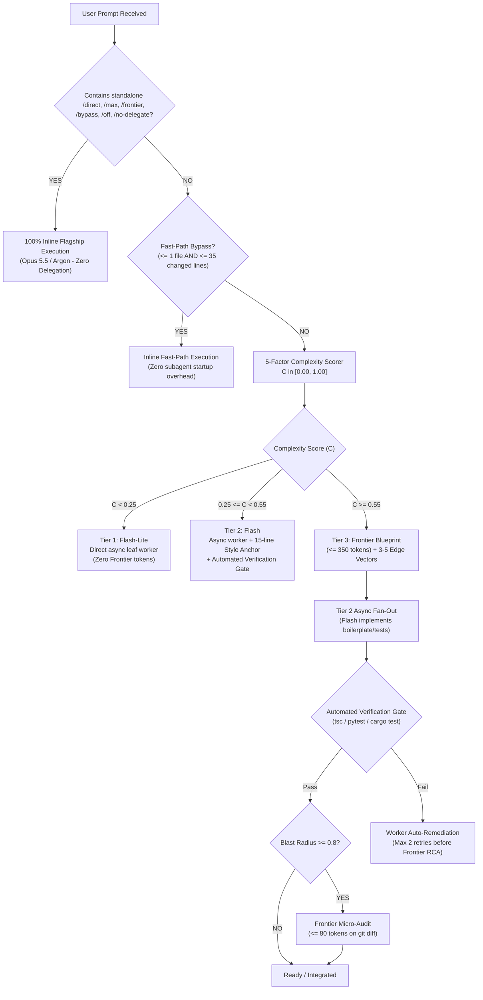

# Frontier-Guard-Handoff (v3.1)

[](https://github.com/KleiinMoretti/frontier-guard-handoff)
[](https://github.com/KleiinMoretti/frontier-guard-handoff)
[](https://python.org)
[](https://github.com/KleiinMoretti/frontier-guard-handoff)
[](LICENSE)

> **Universal Quota-Preserving Adaptive Delegator for Google Antigravity & Frontier Coding Agents.**

`frontier-guard-handoff` is an agentic orchestration protocol designed to protect rate limits and token budgets on flagship frontier models (Claude Opus 5.5, Gemini Argon, and Thinking tiers) without compromising code quality. It enforces cheap-by-default execution, blueprint-only reasoning, 15-line style-clone anchors, anti-recursion worker termination guards, and instant per-prompt bypass switches.

---

## 🏛️ Architecture Overview



---

## ✨ Core Features & Principles

### 1. 🛡️ Subagent Anti-Recursion Guard (Rule #0.1)
Spawned subagents are structurally forbidden from recursively delegating. Worker prompts include `<worker_anti_recursion_guard>` instructions requiring direct implementation and return of `<subtask_result>`. Custom worker types can be registered with `define_subagent(EnableSubagentTools: false)` for strict runtime enforcement.

### 2. ⚡ Instant Per-Prompt Kill-Switch (`/direct`, `/max`, `/frontier`, `/bypass`, `/off`, `/no-delegate`)
Prepend or append any supported slash-keyword to bypass delegation instantly for that turn.
* Boundary-aware regex prevents false positives on file paths (`src/direct/service.ts`) or URLs (`https://example.com/max/test`).
* Automatically re-arms on subsequent prompts omitting the keyword.

### 3. ⏱️ Fast-Path Inline Bypass
Tasks touching `<= 1 file` with `<= 35 changed lines`, single diagnostic commands, or quick conversational queries are executed inline immediately to avoid subagent startup latency.

### 4. 🧮 Deterministic 5-Factor Complexity Scorer
Calculates objective task difficulty across 5 dimensions:
$$C = 0.25(\text{Coupling}) + 0.25(\text{Concurrency}) + 0.20(\text{Novelty}) + 0.15(\text{BlastRadius}) + 0.15(\text{Irreversibility})$$

### 5. ✂️ Polyglot Context Slicing + Style-Clone Anchors
* **Python**: Parses AST via `ast.parse()` to extract complete function definitions, parameter lists, type annotations, and class methods.
* **TypeScript**: Extracts full `interface`, `enum`, and `type` blocks (up to 25 lines) and balances multi-line function signatures.
* **Rust / Go / Java / C# / C++**: Multi-line parenthesis balancing up to signature termination.
* **15-Line Style-Clone Anchor**: Attaches an exact exemplar from your codebase so `flash` replicates local patterns, imports, and error handling.
* **XML CDATA Wrappers**: Prevents generic signatures like `Result<T, E>` or chained bash commands like `tsc && vitest` from breaking XML envelope parsing.

### 6. 🚫 Strict Frontier Firewall (Opus 5.5 / Gemini Argon)
Frontier tokens are strictly reserved for:
* `BLUEPRINT_ONLY` (`<= 350` tokens)
* `ROOT_CAUSE_DIAGNOSIS` (`<= 250` tokens, unlocked only after 2 worker failures)
* `MICRO_AUDIT` (`<= 80` tokens on unified diffs)

Banned on flagship models: raw boilerplate, full unit test files, DTO scaffolds, regexes, data formatting, and routine comments.

---

## 📦 Installation & Setup

### Option A: Antigravity Global Skill
Copy or clone to your global skills directory:
```bash
git clone https://github.com/KleiinMoretti/frontier-guard-handoff.git ~/.gemini/config/skills/frontier-guard-handoff
```

### Option B: Project / Workspace Skill
Add to your project's `.agents` directory:
```bash
git clone https://github.com/KleiinMoretti/frontier-guard-handoff.git .agents/skills/frontier-guard-handoff
cp .agents/skills/frontier-guard-handoff/frontier-guard.config.json .agents/frontier-guard.config.json
```

Add the following rule to your workspace `GEMINI.md`:
```markdown
# Workspace Quota-Preserving Adaptive Delegator Rule (`frontier-guard-handoff` v3.1)

Always enforce the **Quota-Preserving Adaptive Delegator (`frontier-guard-handoff`)** protocol to preserve rate limits and token quota on flagship models (Claude Opus 5.5, Gemini Argon, and Thinking tiers):

0. **Subagent Anti-Recursion Guard (Rule #0.1 - Worker Termination Rule)**:
   - If you are a spawned subagent (i.e., your prompt contains `<subtask_envelope>` or `[WORKER_MODE]`, or you were invoked to implement a specific subtask), **DO NOT** delegate further or spawn sub-subagents. Execute the task directly, run the verification command, and return `<subtask_result>`.
   - Recommend using `define_subagent` with `EnableSubagentTools: false` for worker subagents so recursion is structurally impossible in runtime.

1. **Instant Per-Prompt Kill-Switch (`/direct`, `/max`, `/frontier`, `/bypass`, `/off`, `/no-delegate`)**:
   - If the user's prompt contains a standalone slash-keyword `/direct`, `/max`, `/frontier`, `/bypass`, `/off`, or `/no-delegate` (preceded by start-of-line or whitespace, NOT part of a file path or URL), **immediately disable** all downward delegation and token caps for that turn. Execute 100% of the request inline using the active flagship model.
   - Automatically re-enable delegation on the next prompt that does not contain a bypass keyword.

2. **Fast-Path Inline Bypass (Micro-Tasks)**:
   - Execute inline immediately (do not spawn subagents) when answering conversational questions, running 1–2 diagnostic commands, or editing `<= 1 file` with `<= 35 changed lines`.

3. **Cheap-by-Default Asynchronous Offloading (Multi-File / Heavy Generation)**:
   - For tasks touching `>= 2 files` or generating `> 35 lines` of boilerplate, unit tests, regexes, data formatting, UI scaffolding, SQL/IaC blocks, or documentation:
     - **BANNED on Opus 5.5 / Argon**: Raw boilerplate, unit test suites, data serialization, regex, linear refactoring, docstrings, or syntax fixes.
     - **Plan Deconstruction**: Keep architectural synthesis on the primary model as a compact **Blueprint (`<= 350` tokens)** + **3–5 Adversarial Edge Vectors**, then fan out heavy code/test/doc generation asynchronously via `invoke_subagent` with `Model: "flash"` (Tier 2) or `Model: "flash_lite"` (Tier 1).
     - **Surgical Context Slicing**: Strip chat history; pass only exported multi-line type/interface/function signatures + a **15-line Style-Clone Anchor** from an existing repo file via `scripts/context_slicer.py`.
     - **Zero-Idle Parallel Work**: While background subagents run, immediately continue local non-blocking tasks (wiring, configs, exports) and verify outputs with local compiler/test gates upon completion.
     - For full multi-domain specifications, consult `.agents/skills/frontier-guard-handoff/SKILL.md`.
```

---

## ⚙️ Configuration (`frontier-guard.config.json`)

Configure thresholds, token limits, and keyword overrides in `frontier-guard.config.json`:

```json
{
  "version": "3.1.0",
  "quality_profile": "ZERO_REGRESSION",
  "override_keywords": [
    "/direct",
    "/max",
    "/frontier",
    "/bypass",
    "/off",
    "/no-delegate"
  ],
  "allow_any_slash_keyword_override": false,
  "subagent_anti_recursion_guard": true,
  "fast_path_inline_bypass": {
    "max_files": 1,
    "max_changed_lines": 35
  },
  "token_budget_cap": {
    "session_total_tokens": 250000,
    "frontier_blueprint_input_cap": 6000,
    "frontier_blueprint_output_cap": 350,
    "frontier_diagnosis_output_cap": 250,
    "frontier_micro_audit_output_cap": 80,
    "worker_input_cap_per_call": 10000
  },
  "max_frontier_calls_per_run": 3,
  "auto_downgrade_threshold": {
    "quota_remaining_pct": 20,
    "complexity_score_ceiling": 0.55,
    "tier1_max_complexity": 0.25,
    "max_tier1_attempts_before_tier2": 1,
    "max_tier2_attempts_before_frontier": 2
  },
  "context_hygiene": {
    "strip_chat_history": true,
    "strip_global_system_prompt": true,
    "ast_signature_only_for_deps": true,
    "require_style_clone_anchor": true,
    "require_adversarial_test_seeds": true
  }
}
```

---

## 🛠️ CLI Reference (`context_slicer.py`)

The included polyglot context slicer automates prompt evaluation, scoring, and XML subtask construction:

### 1. Run Built-in Automated Self-Tests
```bash
python scripts/context_slicer.py test
```

### 2. Check Prompt for Override or Fast-Path Bypass
```bash
python scripts/context_slicer.py check --prompt "Refactor auth module /direct"
# Output: {"delegation_enabled": false, "reason": "Kill-switch keyword detected: /direct", "execution_mode": "INLINE_FRONTIER_DIRECT"}

python scripts/context_slicer.py check --prompt "inspect src/direct/file.ts" --files 2 --lines 50
# Output: {"delegation_enabled": true, "reason": "Standard Quota-Preserving Adaptive Delegation active", "execution_mode": "ADAPTIVE_DELEGATION"}
```

### 3. Calculate 5-Factor Complexity Score
```bash
python scripts/context_slicer.py score \
  --coupling 0.8 \
  --concurrency 0.7 \
  --novelty 0.6 \
  --blast-radius 0.9 \
  --irreversibility 0.8
```

### 4. Build Compact XML Subtask Envelope
```bash
python scripts/context_slicer.py slice \
  --id "sub-01" \
  --objective "Implement token validation with Result<T, E>" \
  --tier "tier2_flash" \
  --deps "src/types.ts" "src/auth.ts" \
  --anchor-file "src/session.ts" \
  --anchor-start 1 \
  --verify-cmd "npx tsc --noEmit && npx vitest run"
```

---

## 🧪 Verification Matrix

| Test Suite | Purpose | Status |
| :--- | :--- | :--- |
| **Override Regex & Rejection** | Validates keyword matching and rejects mid-path false positives (`src/direct/...`) | ✅ Passed |
| **Config Loader & Fallbacks** | Auto-discovers and shallow-merges JSON config from workspace/parent hierarchy | ✅ Passed |
| **Complexity Scorer Bounds** | Enforces $[0.0, 1.0]$ clamp and raises `ValueError` on out-of-bound inputs | ✅ Passed |
| **Python AST Parser** | Extracts complete parameter lists, type annotations, and class methods | ✅ Passed |
| **TypeScript Block Extractor** | Captures complete multi-line `interface`, `enum`, and `type` blocks | ✅ Passed |
| **Polyglot Parenthesis Balancer**| Balances multi-line signatures for Rust, Go, Java, and C# without ReDoS risk | ✅ Passed |
| **XML CDATA Validator** | Ensures generics (`Result<T, E>`) and commands (`&&`) parse cleanly via `ElementTree` | ✅ Passed |

---

## 📄 License

MIT © [KleiinMoretti](https://github.com/KleiinMoretti)
