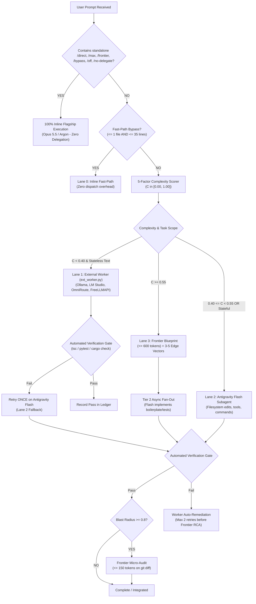

# Frontier-Guard-Handoff (v4.0)

[](https://github.com/KleiinMoretti/frontier-guard-handoff)
[](https://github.com/KleiinMoretti/frontier-guard-handoff)
[](https://python.org)
[](https://github.com/KleiinMoretti/frontier-guard-handoff)
[](LICENSE)

> **Universal Quota-Preserving Adaptive Delegator with External Worker Lane & Quality Guard.**

`frontier-guard-handoff` is an agentic orchestration protocol designed to protect rate limits and token budgets on flagship frontier models (Claude Opus 5.5, Gemini Argon, and Thinking tiers) without compromising code quality. It enforces cheap-by-default execution, blueprint-only reasoning, 15-line style-clone anchors, anti-recursion worker termination guards, external worker gateways (Ollama, LM Studio, OmniRoute, FreeLLMAPI), secret scrubbing, and automated quality ledger demotion.

---

## 🏛️ Architecture Overview: The Lane Ladder

Workloads are segregated into four execution lanes based on task scope and complexity:



---

## ✨ Core Features & Principles

### 1. 🛡️ Subagent Anti-Recursion Guard (Rule #0.1)
Spawned subagents are structurally forbidden from recursively delegating. Worker prompts include `<worker_anti_recursion_guard>` instructions requiring direct implementation and return of `<subtask_result>`. Custom worker types can be registered with `define_subagent(EnableSubagentTools: false)` for strict runtime enforcement.

### 2. ⚡ Instant Per-Prompt Kill-Switch (`/direct`, `/max`, `/frontier`, `/bypass`, `/off`, `/no-delegate`)
Prepend or append any supported slash-keyword to bypass delegation instantly for that turn.
* Boundary-aware regex prevents false positives on file paths (`src/direct/service.ts`) or URLs (`https://example.com/max/test`).
* Automatically re-arms on subsequent prompts omitting the keyword.

### 3. ⏱️ Fast-Path Inline Bypass
Tasks touching `<= 1 file` with `<= 35 changed lines`, single diagnostic commands, or quick conversational queries are executed inline immediately to avoid subagent startup latency.

### 4. 🌐 External Worker Lane (`scripts/ext_worker.py`)
Stateless generation tasks (tests, docstrings, regex, DTO boilerplate, data formatting) at complexity $C < 0.40$ are offloaded to OpenAI-compatible endpoints:
* **Local Gateways First**: Seamless routing to local Ollama (`qwen2.5-coder:14b`) or LM Studio.
* **Remote Gateways**: Fallback to OmniRoute or FreeLLMAPI with Bearer token authentication.
* **Text-In / Text-Out**: External models have zero filesystem or tool access; the orchestrator writes the files and runs verification gates.
* **Single-Retry Fallback**: If an external generation fails verification, it retries **ONCE** on an Antigravity Flash subagent.

### 5. 🛡️ Quality Guard & Automated Demotion
Prevents regressions from low-quality free models:
* **Reasoning Protection**: Token caps apply to the emitted blueprint artifact, never to the model's internal thinking trace. Blueprint cap is raised to 600 tokens, diagnosis to 400, and audit to 150.
* **`flash_lite` Banned for Code**: Restricted strictly to documentation, formatting, and web research.
* **Complexity Ceiling**: External free models never touch code with $C \ge 0.40$.
* **Automated Ledger Demotion**: Tracks pass/fail outcomes in `.agents/fgh-ledger.jsonl`. Any gateway falling below 70% pass rate over the last 10 records is automatically demoted.

### 6. 🔒 Secret Scrubber & Provider Policy
* **Sanctioned Providers Only**: Use official provider free tiers (Google AI Studio, Groq, Mistral, Cerebras) or self-hosted models. Never use reverse-engineered web sessions, cookie scrapers, or shared leaked keys.
* **Pre-Flight Scrubber**: Automatically redacts AWS keys, `sk-` tokens, GitHub PATs, Google AIza keys, Slack tokens, private keys, JWTs, and credential lines while preserving normal code identifiers.
* **Local-Only Privacy Mode**: Set `"privacy_mode": "local_only"` to restrict all external offloading to local Ollama / LM Studio instances.

---

## 📦 Installation & Setup

### Option A: Antigravity Global Skill
Copy or clone to your global skills directory:
```bash
git clone https://github.com/KleiinMoretti/frontier-guard-handoff.git ~/.gemini/config/skills/frontier-guard-handoff
```

### Option B: Project / Workspace Skill
Add to your project's `.agents` directory:
```bash
git clone https://github.com/KleiinMoretti/frontier-guard-handoff.git .agents/skills/frontier-guard-handoff
cp .agents/skills/frontier-guard-handoff/frontier-guard.config.json .agents/frontier-guard.config.json
```

Add the following rule to your workspace `GEMINI.md`:
```markdown
# Workspace Quota-Preserving Adaptive Delegator Rule (`frontier-guard-handoff` v4.0)

Always enforce the **Quota-Preserving Adaptive Delegator (`frontier-guard-handoff`)** protocol to preserve rate limits and token quota on flagship models (Claude Opus 5.5, Gemini Argon, and Thinking tiers):

0. **Subagent Anti-Recursion Guard (Rule #0.1 - Worker Termination Rule)**:
   - If you are a spawned subagent (i.e., your prompt contains `<subtask_envelope>` or `[WORKER_MODE]`, or you were invoked to implement a specific subtask), **DO NOT** delegate further or spawn sub-subagents. Execute the task directly, run the verification command, and return `<subtask_result>`.
   - Recommend using `define_subagent` with `EnableSubagentTools: false` for worker subagents so recursion is structurally impossible in runtime.

1. **Instant Per-Prompt Kill-Switch (`/direct`, `/max`, `/frontier`, `/bypass`, `/off`, `/no-delegate`)**:
   - If the user's prompt contains a standalone slash-keyword `/direct`, `/max`, `/frontier`, `/bypass`, `/off`, or `/no-delegate` (preceded by start-of-line or whitespace, NOT part of a file path or URL), **immediately disable** all downward delegation and token caps for that turn. Execute 100% of the request inline using the active flagship model.
   - Automatically re-enable delegation on the next prompt that does not contain a bypass keyword.

2. **Fast-Path Inline Bypass (Micro-Tasks)**:
   - Execute inline immediately (do not spawn subagents) when answering conversational questions, running 1–2 diagnostic commands, or editing `<= 1 file` with `<= 35 changed lines`.

3. **Cheap-by-Default Asynchronous Offloading (Multi-File / Heavy Generation)**:
   - For tasks touching `>= 2 files` or generating `> 35 lines` of boilerplate, unit tests, regexes, data formatting, UI scaffolding, SQL/IaC blocks, or documentation:
     - **BANNED on Opus 5.5 / Argon**: Raw boilerplate, unit test suites, data serialization, regex, linear refactoring, docstrings, or syntax fixes.
     - **Plan Deconstruction**: Keep architectural synthesis on the primary model as a compact **Blueprint (`<= 600` tokens)** + **3–5 Adversarial Edge Vectors**, then fan out heavy code/test/doc generation asynchronously via `ext_worker.py` (Lane 1, $C < 0.40$) or `invoke_subagent` with `Model: "flash"` (Lane 2).
     - **Surgical Context Slicing**: Strip chat history; pass only exported multi-line type/interface/function signatures + a **15-line Style-Clone Anchor** from an existing repo file via `scripts/context_slicer.py`.
     - **Zero-Idle Parallel Work**: While background subagents run, immediately continue local non-blocking tasks (wiring, configs, exports) and verify outputs with local compiler/test gates upon completion.
     - For full multi-domain specifications, consult `.agents/skills/frontier-guard-handoff/SKILL.md`.
```

---

## ⚙️ Configuration (`frontier-guard.config.json`)

Configure thresholds, external gateways, privacy modes, and token caps:

```json
{
  "version": "4.0.0",
  "quality_profile": "ZERO_REGRESSION",
  "override_keywords": [
    "/direct",
    "/max",
    "/frontier",
    "/bypass",
    "/off",
    "/no-delegate"
  ],
  "allow_any_slash_keyword_override": false,
  "subagent_anti_recursion_guard": true,
  "fast_path_inline_bypass": {
    "max_files": 1,
    "max_changed_lines": 35
  },
  "quality_guard": {
    "cap_blueprint_artifact_not_reasoning": true,
    "external_lane_max_complexity": 0.40,
    "flash_lite_allowed_for_code": false,
    "lane_demotion_min_pass_rate": 0.70,
    "lane_demotion_window": 10,
    "ledger_path": ".agents/fgh-ledger.jsonl"
  },
  "external_lane": {
    "enabled": true,
    "privacy_mode": "scrub",
    "allow_remote_gateways": true,
    "request_timeout_s": 90,
    "max_retries": 1,
    "max_output_tokens": 4096,
    "gateways": [
      {
        "name": "ollama",
        "base_url": "http://127.0.0.1:11434/v1",
        "api_key_env": null,
        "local": true,
        "model": "qwen2.5-coder:14b"
      },
      {
        "name": "lmstudio",
        "base_url": "http://127.0.0.1:1234/v1",
        "api_key_env": null,
        "local": true,
        "model": "local-model"
      },
      {
        "name": "omniroute",
        "base_url": "http://127.0.0.1:20128/v1",
        "api_key_env": "OMNIROUTE_API_KEY",
        "local": false,
        "model": "auto"
      },
      {
        "name": "freellmapi",
        "base_url": "http://127.0.0.1:3001/v1",
        "api_key_env": "FREELLMAPI_API_KEY",
        "local": false,
        "model": "auto"
      }
    ]
  },
  "token_budget_cap": {
    "session_total_tokens": 250000,
    "frontier_blueprint_input_cap": 6000,
    "frontier_blueprint_output_cap": 600,
    "frontier_diagnosis_output_cap": 400,
    "frontier_micro_audit_output_cap": 150,
    "worker_input_cap_per_call": 10000
  }
}
```

---

## 🛠️ CLI Reference

### 1. `ext_worker.py` (External Gateway & Quality Driver)

#### Health Check
```bash
python scripts/ext_worker.py health
# Output: [{"name": "ollama", "reachable": false, "local": true, "model": "qwen2.5-coder:14b", "key_present": false}, ...]
```

#### Run Stateless Worker Generation
```bash
python scripts/ext_worker.py run \
  --envelope envelope.xml \
  --out src/utils/formatter.py \
  --complexity 0.25 \
  --task-id "task-101"
```

#### Record Verification Outcome
```bash
python scripts/ext_worker.py record \
  --task-id "task-101" \
  --gateway "ollama" \
  --passed true \
  --note "pytest passed cleanly"
```

#### View Quality Guard Stats & Demotions
```bash
python scripts/ext_worker.py stats
# Output: {"gateways": {"ollama": {"total_recent": 5, "passed_recent": 5, "pass_rate": 1.0, "demoted": false}}}
```

#### Run Offline Self-Tests
```bash
python scripts/ext_worker.py test
```

---

### 2. `context_slicer.py` (Context Slicer & Complexity Scorer)

#### Check Prompt Override or Bypass
```bash
python scripts/context_slicer.py check --prompt "Refactor auth module /direct"
# Output: {"delegation_enabled": false, "reason": "Kill-switch keyword detected: /direct", "execution_mode": "INLINE_FRONTIER_DIRECT"}
```

#### Calculate Complexity Score & Execution Lane
```bash
python scripts/context_slicer.py score \
  --coupling 0.3 \
  --concurrency 0.2 \
  --novelty 0.3 \
  --blast-radius 0.2 \
  --irreversibility 0.2
# Output: {"domain": "code", "complexity_score": 0.245, "recommended_tier": "tier2_flash", "lane": "external_or_flash"}
```

#### Build XML Subtask Envelope
```bash
python scripts/context_slicer.py slice \
  --id "sub-01" \
  --objective "Implement token validation with Result<T, E>" \
  --tier "tier2_flash" \
  --deps "src/types.ts" "src/auth.ts" \
  --anchor-file "src/session.ts" \
  --anchor-start 1 \
  --verify-cmd "npx tsc --noEmit && npx vitest run"
```

#### Run Offline Self-Tests
```bash
python scripts/context_slicer.py test
```

---

## 🧪 Verification Matrix

| Test Suite | Purpose | Status |
| :--- | :--- | :--- |
| **Override Regex & Rejection** | Validates keyword matching and rejects mid-path false positives (`src/direct/...`) | ✅ Passed |
| **Config Loader & Fallbacks** | Auto-discovers and shallow-merges JSON config from workspace/parent hierarchy | ✅ Passed |
| **Complexity Scorer & Lane Router** | Enforces $[0.0, 1.0]$ clamp, assigns Lane 1–3, upgrades code tier from `flash_lite` to `flash` | ✅ Passed |
| **Python AST Parser** | Extracts complete parameter lists, type annotations, and class methods | ✅ Passed |
| **TypeScript Block Extractor** | Captures complete multi-line `interface`, `enum`, and `type` blocks | ✅ Passed |
| **Polyglot Parenthesis Balancer**| Balances multi-line signatures for Rust, Go, Java, and C# without ReDoS risk | ✅ Passed |
| **XML CDATA Validator** | Ensures generics (`Result<T, E>`) and commands (`&&`) parse cleanly via `ElementTree` | ✅ Passed |
| **Secret Scrubber & Redactor** | Strips AWS keys, `sk-` tokens, GitHub PATs, AIza, Slack, and private keys | ✅ Passed |
| **Gateway Privacy Filter** | Restricts execution to local engines when `privacy_mode` is `local_only` | ✅ Passed |
| **Quality Ledger & Auto-Demotion**| Gracefully handles corrupt ledger entries and demotes gateways with pass rate < 70% | ✅ Passed |

---

## 📄 License

MIT © [KleiinMoretti](https://github.com/KleiinMoretti)
