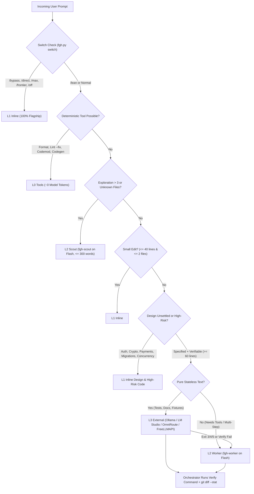

# Frontier Guard v5 (`frontier-guard-handoff`)

[](./skills/frontier-guard-handoff/SKILL.md)
[-green.svg)](./skills/frontier-guard-handoff/scripts/fgh.py)
[](./LICENSE)

**Quota-preserving work routing for Google Antigravity workflows.**

Frontier Guard v5 cuts flagship model token and rate-limit burn (Claude Opus, Gemini Argon / Pro / Thinking tiers) **without sacrificing output quality** by targeting the real sources of quota drain—**context resent on every step**, **turn count**, and **unspecified delegation**—and routing work across five deterministic lanes.

---

## Why v5 Was Rebuilt from the Ground Up

1. **Real Quota Physics, Not Fake Score Formulas**: Flagship quota is burned primarily by re-sending bloated context on every step (reading entire 2,000-line files, noisy command output, multi-file exploration logs), not just output tokens. v5 enforces **Search-Before-Read**, **Output Capping**, **L2 Scout Exploration**, and **L0 Deterministic Tooling** first.
2. **Never Cap Reasoning**: Output length caps apply **only** to worker briefs and worker completion reports—never to the flagship model's internal reasoning or architectural design.
3. **Specifiability + Verifiability Gate**: Nothing is delegated to a worker unless (a) all architectural decisions are already settled in a compact brief, and (b) a mechanical command (`pytest`, `tsc`, `vitest`, `cargo check`) verifies pass/fail.
4. **Single Zero-Dependency CLI (`fgh.py`)**: Replaces fragmented scripts with a unified, fully tested Python 3.9+ standard-library CLI (`switch`, `route`, `brief`, `sig`, `scrub`, `ext`, `ledger`, `install`, `selftest`).

---

## 5-Lane Architecture



---

## Quickstart & Installation

### Install Globally + in Workspace
```bash
# Install into ~/.gemini/config (global skill + compact GEMINI.md rule)
python skills/frontier-guard-handoff/scripts/fgh.py install --target global --replace-legacy

# Install into current workspace (.agents/skills + workspace GEMINI.md rule)
python skills/frontier-guard-handoff/scripts/fgh.py install --target workspace --replace-legacy
```

### Run the Bundled Self-Test Suite
```bash
python skills/frontier-guard-handoff/scripts/fgh.py selftest
```

---

## Instant Per-Turn Switches

| Switch | Behavior for Current Turn |
| :--- | :--- |
| `/bypass`, `/direct`, `/max`, `/frontier`, `/off`, `/no-delegate` | Suspends all delegation and executes 100% inline on the active flagship model. |
| `/lean` | Lowers delegation thresholds (`inline <= 15 lines / 1 file`, `delegate >= 30 lines`) for maximum quota preservation. |

*(Switches only trigger as standalone tokens—never inside file paths like `src/direct/index.ts` or URLs.)*

---

## CLI Reference (`scripts/fgh.py`)

```bash
# 1. Detect prompt switches (/bypass, /direct, /lean)
python skills/frontier-guard-handoff/scripts/fgh.py switch "please /lean add unit tests"

# 2. Get a deterministic lane recommendation
python skills/frontier-guard-handoff/scripts/fgh.py route \
  --kind generate --lines 160 --files 2 --spec full \
  --verify "npx vitest run" --text-only --task "parser unit tests"

# 3. Extract polyglot public signatures only (Py, TS/JS, Go, Rust, Java, C#, Kotlin, Swift, SQL, HCL)
python skills/frontier-guard-handoff/scripts/fgh.py sig src/types.ts src/service.py

# 4. Build a self-contained, secret-scrubbed worker brief
python skills/frontier-guard-handoff/scripts/fgh.py brief \
  --goal "Implement CsvExporter and edge-case tests" \
  --own src/csv.ts src/csv.test.ts \
  --contracts src/types.ts \
  --anchor src/json.ts:10-24 \
  --decision "Return Result<string, ExportError>, never throw" \
  --edge "empty rows" --edge "embedded quotes and newlines" \
  --verify "npx tsc --noEmit && npx vitest run src/csv.test.ts" \
  --out .agents/briefs/csv.md

# 5. Check external gateway health (Ollama, LM Studio, OmniRoute, FreeLLMAPI)
python skills/frontier-guard-handoff/scripts/fgh.py ext health

# 6. Run stateless generation on the external lane & record verification result
python skills/frontier-guard-handoff/scripts/fgh.py ext run \
  --brief .agents/briefs/csv.md --out src/csv.test.ts --task csv-tests
python skills/frontier-guard-handoff/scripts/fgh.py ledger record \
  --lane L3 --gateway ollama --task csv-tests --passed true
python skills/frontier-guard-handoff/scripts/fgh.py ledger stats
```

---

## Repository Layout

```text
frontier-guard-handoff/
├── GEMINI.md
├── LICENSE
├── README.md
└── skills/
    └── frontier-guard-handoff/
        ├── SKILL.md
        ├── config.default.json
        ├── assets/
        │   └── GEMINI.rule.md
        ├── references/
        │   ├── briefs.md
        │   ├── external-lane.md
        │   └── routing.md
        ├── scripts/
        │   └── fgh.py
        └── tests/
            └── test_fgh.py
```

---

## License

Released under the [MIT License](./LICENSE).
