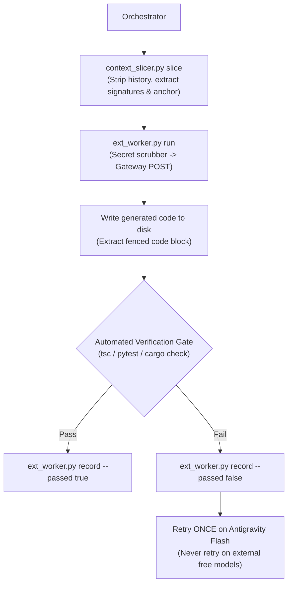

# Universal Quota-Preserving Adaptive Delegator v4.0 (`frontier-guard-handoff`)

## 0. Subagent Worker Anti-Recursion Guard (Rule #0.1)

> [!CAUTION]
> **SUBAGENT WORKER TERMINATION GUARD (MANDATORY)**
> If you are running as a delegated worker subagent (i.e., your prompt contains `<subtask_envelope>` or `[WORKER_MODE]`, or you were invoked to execute a specific subtask):
> - **DO NOT** delegate further or spawn sub-subagents.
> - **DO NOT** invoke `invoke_subagent` or `define_subagent`.
> - Execute the assigned task directly, run the verification command, and return `<subtask_result>`.
>
> **Structural Recursion Prevention**: When configuring worker agents via `define_subagent`, always set `EnableSubagentTools: false` so that recursive subagent dispatch is structurally impossible in the runtime.

---

## 1. Instant Per-Prompt Kill-Switch (`/direct`, `/max`, `/frontier`, `/bypass`, `/off`, `/no-delegate`)

> [!IMPORTANT]
> **PER-PROMPT OVERRIDE RULE**
> If the user's message contains any of the following standalone slash-keywords anywhere in the prompt:
> - **`/direct`** (Primary override keyword)
> - **`/max`**
> - **`/frontier`**
> - **`/bypass`**
> - **`/off`**
> - **`/no-delegate`**
>
> *(Evaluated with boundary-aware regex `(?:^|(?<=\s))(/[a-zA-Z0-9_-]+)(?=\s|$|[.,!?;:])` to prevent mid-path false positives like `src/direct/foo.ts` or URLs)*
>
> **ACTION:** Immediately **SUSPEND** `frontier-guard-handoff` for that entire turn.
> - Do **NOT** offload subtasks to external gateways or Antigravity flash subagents.
> - Do **NOT** cap output tokens to blueprints.
> - Execute 100% of the coding, reasoning, or writing inline using the active flagship model (Opus 5.5 / Gemini Argon).
> - Automatically re-arm `frontier-guard-handoff` on the next user prompt that omits the bypass keyword.

---

## 2. Fast-Path Inline Bypass (Anti-Overhead Guard)

Subagent dispatch and external script execution have a ~1.5–2.5s startup cost. Do **NOT** offload when inline execution is cheaper and faster.

**Execute INLINE immediately (no delegation or subagents) if ANY of the following hold:**
1. The user included `/direct`, `/max`, `/frontier`, `/bypass`, `/off`, or `/no-delegate`.
2. The request is a conversational question, explanation, or <300-token answer.
3. The task modifies **1 file** with an estimated diff of **`<= 35 lines`** of code/text.
4. Executing a single diagnostic CLI command or reading 1–2 files.

For all multi-file, boilerplate-heavy, or high-token generation workloads (`> 35 lines` or `>= 2 files`), route through the **Lane Ladder** below.

---

## 3. The Lane Ladder (Lanes 0–3 Execution Hierarchy)

Workloads are routed through four strictly segregated execution lanes based on task requirements and complexity:

| Lane | Name | Target Engine | Capabilities & Workload Scope |
| :--- | :--- | :--- | :--- |
| **Lane 0** | **Inline Fast-Path** | Flagship inline (Opus / Argon) | Single-turn micro-edits (`<= 1 file`, `<= 35 lines`), `/direct` bypass, diagnostic CLI commands. |
| **Lane 1** | **External Worker** | `scripts/ext_worker.py` -> Ollama / LM Studio (local) or OmniRoute / FreeLLMAPI (remote) | **Stateless text-in / text-out generation only** (No tools, no shell, no file access). Unit tests, docstrings, regex, DTO boilerplate, data formatting. Complexity $C < 0.40$. |
| **Lane 2** | **Antigravity Flash Subagent** | Native `invoke_subagent(Model="flash")` | Stateful subtasks requiring filesystem modifications, tool execution, multi-step CLI commands, or Lane 1 fallback. |
| **Lane 3** | **Frontier Blueprint** | Flagship inline or `invoke_subagent(Model="pro")` | Architectural blueprints (`<= 600` tokens), root-cause diagnosis after 2 failures (`<= 400` tokens), high-blast-radius micro-audits (`<= 150` tokens). $C \ge 0.55$. |

---

## 4. Deterministic 5-Factor Complexity Scorer ($C \in [0.00, 1.00]$) & Lane Routing

Compute the task's **Complexity Score $C$** before dispatching:

$$C = 0.25(\text{Coupling}) + 0.25(\text{Concurrency}) + 0.20(\text{Novelty}) + 0.15(\text{BlastRadius}) + 0.15(\text{Irreversibility})$$

All 5 factors are strictly validated and clamped to $[0.00, 1.00]$.

| Score Range | Execution Lane | Recommended Tier | Strategy |
| :--- | :--- | :--- | :--- |
| **$C < 0.25$** | `external_or_flash` | `tier2_flash` *(Code/UI/Data)* <br>`tier1_flash_lite` *(Research/Docs)* | Attempt Lane 1 external worker (Ollama / OmniRoute). If unavailable or fails, fallback to Antigravity `flash`. |
| **$0.25 \le C < 0.40$** | `external_or_flash` | `tier2_flash` | Attempt Lane 1 external worker with Style-Clone Anchor. Fallback to Lane 2 on failure. |
| **$0.40 \le C < 0.55$** | `antigravity_flash` | `tier2_flash` | Lane 2 Antigravity `flash` subagent + 15-line Style Anchor + Automated Verification Gate. External free models banned. |
| **$C \ge 0.55$** | `frontier_blueprint_then_flash` | `tier3_frontier_blueprint_then_tier2_flash` | Lane 3 Frontier Blueprint (`<= 600` tokens) + 3–5 Adversarial Edge Vectors -> Fan out heavy generation to Lane 2 `flash` -> Verify + Micro-Audit (`<= 150` tokens). |

---

## 5. Lane 1 External Worker Protocol & Automated Quality Demotion

### 5.1 External Execution Lifecycle
External gateways are OpenAI-compatible `/v1/chat/completions` endpoints reached exclusively via `scripts/ext_worker.py`. They are strictly **text-in / text-out** with no access to local tools or files.



1. **Slice Context**: Run `python scripts/context_slicer.py slice` to generate a stripped XML envelope `<subtask_envelope>` (`< 1,500` tokens).
2. **Execute Worker**: Dispatch via `python scripts/ext_worker.py run --envelope <file> --out <dest> --complexity <C> --task-id <id>`.
3. **Automated Verification**: The orchestrator immediately executes the local verification command (`tsc`, `pytest`, `cargo check`).
4. **Record Outcome**: Run `python scripts/ext_worker.py record --task-id <id> --gateway <name> --passed <true|false>` to append to `.agents/fgh-ledger.jsonl`.
5. **Single-Retry Fallback Rule**: If an external generation fails verification, retry **ONCE** on an Antigravity `flash` subagent (Lane 2). **Never retry on another external free model.**

### 5.2 Automated Lane Demotion
The Quality Guard maintains an append-only ledger of outcomes.
- Evaluates the last `lane_demotion_window` records (default: 10 records).
- If a gateway has $\ge 5$ records and its pass rate falls below `lane_demotion_min_pass_rate` (70%), it is **automatically demoted**.
- `ext_worker.py` refuses demoted gateways (exit code 3) and automatically routes to the next reachable gateway or falls back to Antigravity Flash (exit code 4).
- Inspect status at any time: `python scripts/ext_worker.py stats`.

---

## 6. Quality Guard (Root Causes & Structural Guarantees)

Why did naive token-saving degrade code quality in early implementations, and how does v4.0 prevent regressions?

1. **Blueprint Caps Apply to Artifacts, NOT Reasoning**:
   Previous rules mistakenly truncated model thinking. In v4.0, token caps apply strictly to the exported markdown artifact, never to the primary model's internal thinking trace. Artifact caps are increased to avoid premature truncation:
   - Frontier Architectural Blueprint: **`<= 600` output tokens** (up from 350).
   - Root-Cause Diagnosis: **`<= 400` output tokens** (up from 250).
   - Micro-Audit Verdict: **`<= 150` output tokens** (up from 80).
2. **`flash_lite` Banned for Implementation Code**:
   `flash_lite` lacks sufficient reasoning depth for multi-branch syntax, imports, and type systems. `flash_lite` is banned from code, ui, data_sql, and devops domains (`flash_lite_allowed_for_code: false`). It is reserved solely for non-code text formatting, docstrings, and research summarization.
3. **External Free Models Capped at $C < 0.40$**:
   Free and external models are never permitted to touch complex logic ($C \ge 0.40$).
4. **Automated Demotion Threshold**:
   Any gateway producing brittle outputs is demoted once its pass rate dips below 70%.
5. **Mandatory Verification Gate Before Merge**:
   No code generated externally or via subagents is accepted without passing local compiler/test gates.

---

## 7. Provider Policy & Prompt Privacy Safeguards

### 7.1 Provider Policy
- **Permitted**: Official provider free tiers (e.g. Google AI Studio, Groq, Mistral, Cerebras) or self-hosted local models (Ollama, LM Studio) using valid developer API keys.
- **Strictly Prohibited**: Reverse-engineered web session scraping, cookie hijacks, leaked shared API keys, or personal subscription OAuth-to-API bridges. These violate provider Terms of Service, risk account termination, and suffer from high error rates.

### 7.2 Secret Scrubber & Prompt Privacy
External free tiers may log or train on prompt data. To prevent credential leakage:
- `privacy_mode` is set to `"scrub"` by default: `scripts/ext_worker.py` scans and redacts AWS keys, `sk-` tokens, GitHub PATs, Google AIza keys, Slack tokens, private key blocks, JWTs, and credential assignment lines before transmission.
- Ordinary identifiers (`task-runner`, `sketch`, `token_id`) are preserved intact.
- For proprietary codebases, configure `"privacy_mode": "local_only"` in `.agents/frontier-guard.config.json` to route exclusively to local Ollama or LM Studio instances.

---

## 8. Rate-Limit Relief & Model Selection Strategy

The primary model choice in Antigravity is the single largest factor in token quota consumption:
- **Default Workflows**: Use **Gemini 2.5 Flash** or **Gemini Argon** as your primary session model for routine refactoring, implementation, and test cycles.
- **Architectural Escalation**: Switch to **Claude 3.7 Sonnet / Opus** or **Thinking tiers** only for complex architectural design ($C \ge 0.55$) or difficult debugging root causes.
- *Note*: `frontier-guard-handoff` manages subagent dispatch and token caps during execution; it cannot change the primary chat model selected by the user.

---

## 9. Universal Multi-Domain Adapters

`frontier-guard-handoff` adapts its Blueprint, Worker Offload, and Verification Gate across all 5 core domains:

| Domain | Tier 3 Frontier Blueprint (`<= 600` tok) | Worker Offload (External / Flash) | Automated Verification Gate |
| :--- | :--- | :--- | :--- |
| **1. Polyglot Software (TS, Py, Rust, Go, C++, Java, C#)** | State invariants, concurrency locks, interface contracts, <=15-line pseudocode, 3–5 adversarial test vectors. | Full implementation bodies, imports, error wrappers, unit/property tests. | Compiler/typecheck (`tsc`, `pytest`, `cargo check`, `go test`, `dotnet build`, `mvn test`). |
| **2. Frontend UI / CSS / 3D / Motion** | Aesthetic direction, CSS grid/flex geometry, animation easing curves, state-machine transitions, a11y specs. | JSX/HTML component scaffolding, Tailwind/CSS rules, SVG/Three.js boilerplate. | Typecheck + DOM/Console error check + a11y contrast audit. |
| **3. Data Engineering / SQL / Spark / dbt** | Grain definition, join cardinality guards, partitioning/clustering strategy, window-function logic. | Full SQL/SQLX/dbt models, schema YAML files, data-cleaning regexes. | SQL dry-run (`bq query --dry_run` / `EXPLAIN`), null-invariant assertions. |
| **4. DevOps / IaC (Terraform, K8s, CI/CD)** | IAM least-privilege boundary, network topology, rollback safety invariants. | HCL resource blocks, GitHub Actions YAML, Dockerfile multi-stage boilerplate. | `terraform validate`, `kubectl --dry-run=client`, YAML schema lint. |
| **5. Deep Research / Strategy / Writing** | Core thesis, analytical framework, counter-arguments, section outline, falsifiable claims checklist. | Parallel doc/web fetching (`flash_lite`), section drafting, formatting, tables. | **Citation Audit**: Verify every quantitative claim maps to a retrieved source URL/file. |

---

## 10. Strict Frontier-Tier Gatekeeping (Opus 5.5 / Argon Firewall)

> [!CAUTION]
> **BANNED ON FRONTIER MODELS (Unless `/direct` is active)**
> Never burn Opus or Argon output tokens on:
> - Writing raw boilerplate, DTOs, CRUD scaffolds, or config files (`JSON`/`YAML`/`TOML`)
> - Writing full unit test files or mock fixtures (Frontier only emits 3–5 bullet *Adversarial Edge Vectors*)
> - Data formatting, CSV/JSON/Markdown table serialization, or regex construction
> - Linear script refactoring, symbol renaming, file splitting, or barrel exports (`index.ts`)
> - Routine docstrings, JSDoc/TSDoc, READMEs, or inline comments
> - Syntax error fixes or mechanical linter remediation

> [!IMPORTANT]
> **PERMITTED FRONTIER MODES (Strictly Token-Capped)**
> 1. `BLUEPRINT_ONLY` (`<= 600` output tokens): Architectural synthesis, novel algorithms, distributed concurrency state machines, UI design specs.
> 2. `ROOT_CAUSE_DIAGNOSIS` (`<= 400` output tokens): Unlocked **only after** a Tier 2 worker fails 2 attempts with compiler/test stderr attached.
> 3. `MICRO_AUDIT` (`<= 150` output tokens): Reviews a unified `git diff` on high-blast-radius tasks (`blast_radius >= 0.8`) and outputs `VERDICT: PASS` or `VERDICT: PATCH <line>: <fix>`.

---

## 11. Surgical Context Slicing + Style-Clone Protocol

Never pass chat history or whole dependency files to a subagent. Use `scripts/context_slicer.py` to construct a compact, XML-valid `<subtask_envelope>` (`< 1,500` tokens):

1. **Zero Chat History**: Strip all prior conversation turns and unrelated tool outputs.
2. **Polyglot Signature Slicing**:
   - Python (`.py`): Parsed via `ast.parse()` to extract complete parameter lists, type annotations, return types, and class methods.
   - TypeScript (`.ts`, `.tsx`): Extracts entire `interface`, `enum`, and `type` blocks (up to 25 lines) and balances multi-line function signatures up to `;`.
   - Rust, Go, Java, C#, C++, SQL, HCL: Multi-line balanced signatures up to `{` or `;`.
3. **15-Line Style-Clone Anchor**: Attach one 15-line snippet from an existing file in the repo so workers mirror local conventions.
4. **Adversarial Test Seeds**: Attach the 3–5 edge cases generated by the Frontier blueprint.
5. **XML CDATA Wrappers**: All signatures, anchor snippets, objectives, and test commands are wrapped in `<![CDATA[ ... ]]>` to prevent generics (`Result<T, E>`) or shell operators (`&&`) from corrupting envelope XML.

---

## 12. Asynchronous Non-Blocking Execution Lifecycle

1. **Partition Work**:
   - **Background Set**: Isolated module coding, unit tests, docstrings, data formatting.
   - **Local Set**: Barrel exports (`index.ts`), configs, dependencies, wiring.
2. **Dispatch & Continue**:
   - Launch background subagents or external worker script.
   - Immediately proceed with local orchestrator tasks without idling.
3. **Verification**:
   - Verify upon completion with local test gates (`tsc`, `pytest`).

---

## 13. Antigravity Tool & Configuration Bindings

### 13.1 Configuration Schema (`.agents/frontier-guard.config.json`)
```json
{
  "version": "4.0.0",
  "quality_profile": "ZERO_REGRESSION",
  "override_keywords": [
    "/direct",
    "/max",
    "/frontier",
    "/bypass",
    "/off",
    "/no-delegate"
  ],
  "allow_any_slash_keyword_override": false,
  "subagent_anti_recursion_guard": true,
  "fast_path_inline_bypass": {
    "max_files": 1,
    "max_changed_lines": 35
  },
  "quality_guard": {
    "cap_blueprint_artifact_not_reasoning": true,
    "external_lane_max_complexity": 0.40,
    "flash_lite_allowed_for_code": false,
    "lane_demotion_min_pass_rate": 0.70,
    "lane_demotion_window": 10,
    "ledger_path": ".agents/fgh-ledger.jsonl"
  },
  "external_lane": {
    "enabled": true,
    "privacy_mode": "scrub",
    "allow_remote_gateways": true,
    "request_timeout_s": 90,
    "max_retries": 1,
    "max_output_tokens": 4096,
    "gateways": [
      {
        "name": "ollama",
        "base_url": "http://127.0.0.1:11434/v1",
        "api_key_env": null,
        "local": true,
        "model": "qwen2.5-coder:14b"
      },
      {
        "name": "lmstudio",
        "base_url": "http://127.0.0.1:1234/v1",
        "api_key_env": null,
        "local": true,
        "model": "local-model"
      },
      {
        "name": "omniroute",
        "base_url": "http://127.0.0.1:20128/v1",
        "api_key_env": "OMNIROUTE_API_KEY",
        "local": false,
        "model": "auto"
      },
      {
        "name": "freellmapi",
        "base_url": "http://127.0.0.1:3001/v1",
        "api_key_env": "FREELLMAPI_API_KEY",
        "local": false,
        "model": "auto"
      }
    ]
  },
  "token_budget_cap": {
    "session_total_tokens": 250000,
    "frontier_blueprint_input_cap": 6000,
    "frontier_blueprint_output_cap": 600,
    "frontier_diagnosis_output_cap": 400,
    "frontier_micro_audit_output_cap": 150,
    "worker_input_cap_per_call": 10000
  }
}
```

### 13.2 Gateway Setup & Health
Set up local or remote gateways:
```bash
# Option 1: Local Ollama
ollama pull qwen2.5-coder:14b

# Option 2: OmniRoute Gateway
npx omniroute # running on port 20128
export OMNIROUTE_API_KEY="your-key"

# Check gateway health
python scripts/ext_worker.py health
```

---

## 14. Automated Verification & Testing

Verify the test suites at any time:
```powershell
python scripts/context_slicer.py test
python scripts/ext_worker.py test
python scripts/ext_worker.py health
```
Both test suites validate 100% of kill-switch parsing, complexity scoring, lane ladder routing, ReDoS-free AST extraction, secret scrubbing, gateway selection, and quality ledger auto-demotion without network dependencies.
